# 불량 판정소 튜토리얼

컨베이어로 들어오는 전극 시트를 보고 양품·불량을 빠르게 판정하는 게임.
바로 하기: https://sseongilk.github.io/defect-judge/ (로그인 없음, 휴대폰·PC 모두 가능)

## 1. 시작하기

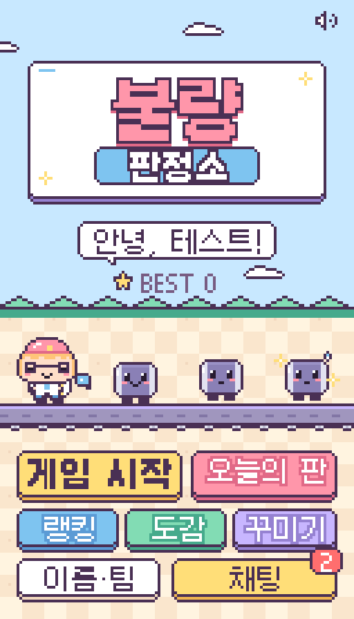

- 처음 「게임 시작」을 누르면 이름 입력 창이 뜸 (최대 8글자)
- 시작 화면 버튼
  - 게임 시작: 일반 게임
  - 오늘의 판: 오늘 하루 모두가 같은 순서의 시트로 겨루는 게임
  - 랭킹 · 도감 · 꾸미기
  - 이름·팀: 이름과 소속 조직 변경
  - 채팅: 모두의 채팅 (빨간 숫자는 안 읽은 글 수)
- 오른쪽 위 스피커 아이콘으로 소리 켜고 끔

 

## 2. 이름·팀 정하기

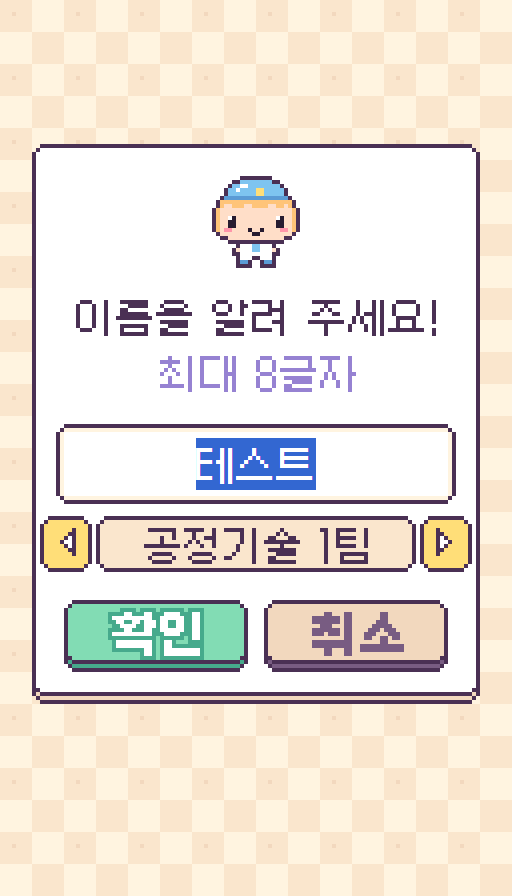

- 이름은 최대 8글자, 랭킹과 채팅에 표시됨
- 이름칸 아래 ◀ ▶ 로 소속 조직 선택
  - 경영기획실, 영업부, 구매부, SW A팀, 검사기술팀, 공정기술 1팀, 공정기술 2팀, SW B팀, 시스템1팀, 시스템2팀, SW기술팀, 설계기술팀, 무소속
- 「확인」을 눌러야 저장됨

 

## 3. 기본 판정

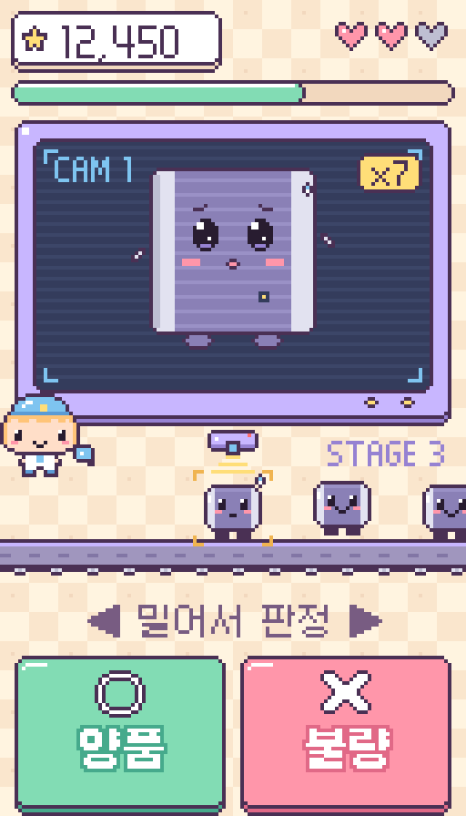

- 모니터(CAM 1)에 나온 시트를 보고 판정
  - 결함이 없으면 **양품**
  - 결함이 있으면 **불량**
- 조작 방법

  | 판정 | 버튼 | 화면 밀기 | 키보드 |
  |---|---|---|---|
  | 양품 | 왼쪽 초록 버튼 | 왼쪽으로 | ← / A / J |
  | 불량 | 오른쪽 빨간 버튼 | 오른쪽으로 | → / D / L |

- 모니터 위 막대가 남은 시간. 다 줄어들면 시간 초과
- 틀리거나 시간 초과면 하트 1개 감소, 하트 3개를 모두 잃으면 게임 끝
- 버튼 바로 위 안내 줄에 판정 결과와 결함 이름이 나옴 (예: 「PERFECT! 크랙」, 「MISS! 핀홀」)

 

## 4. 결함 구별하기

진짜 결함은 **불량**, 가짜 결함은 **양품**으로 판정함.

| 구분 | 이름 | 모양 | 판정 |
|---|---|---|---|
| 진짜 결함 | 핀홀 | 노란 빛이 새는 작은 점 구멍 | 불량 |
| 진짜 결함 | 미코팅 | 코팅이 빠진 회색 네모 | 불량 |
| 진짜 결함 | 크랙 | 흰색 지그재그 금 | 불량 |
| 가짜 결함 | 먼지 | 흩어진 작은 티끌 (스테이지 2부터) | 양품 |
| 가짜 결함 | 빛 반사 | 비스듬한 밝은 줄 (스테이지 3부터) | 양품 |
| 가짜 결함 | 얼룩 | 흐린 자국 (스테이지 4부터) | 양품 |

- 판정 뒤 모니터에 점선 상자로 결함 위치를 보여 줌. 틀렸을 때 어디였는지 확인하는 데 활용
- 처음 본 결함은 도감에 등록됨

## 5. 점수와 스테이지

- 점수 = (100 + 남은 시간 비율 × 100) × (1 + 콤보 × 0.1) × 피버 배수
  - 빨리 맞힐수록 점수가 높음 (남은 시간 60% 넘으면 PERFECT!)
  - 콤보는 연속으로 맞힌 수, 20콤보까지 반영. 모니터 오른쪽 위 「x7」 같은 표시
- 8개 맞힐 때마다 스테이지 상승
  - 제한 시간이 짧아짐 (3.4초 → 최소 1.15초)
  - 결함이 점점 작아짐
  - 스테이지가 오를 때마다 보스 시트 등장

## 6. 특별 상황

### 피버

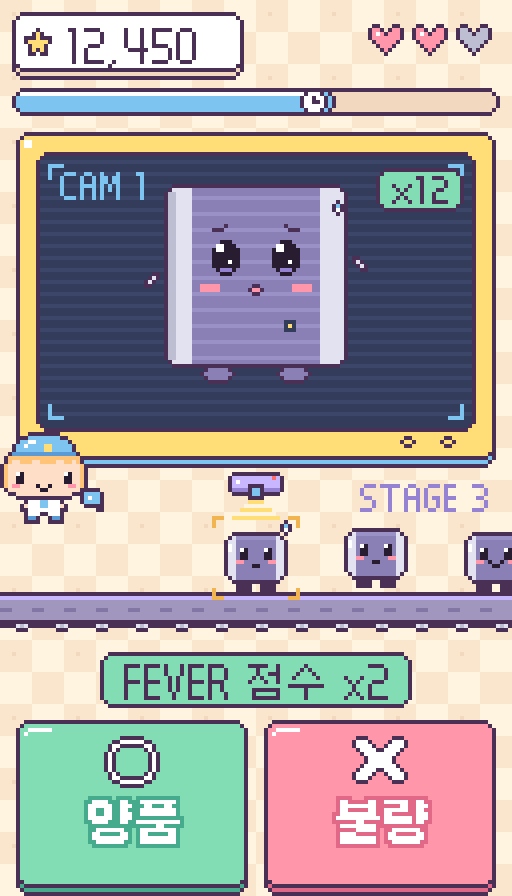

- 10콤보마다 8장 동안 점수 2배
- 모니터·시간 막대가 무지개색으로 바뀌고 안내 줄에 「FEVER 점수 x2」
- 한 번이라도 틀리면 바로 끝남

 

### 보스 시트

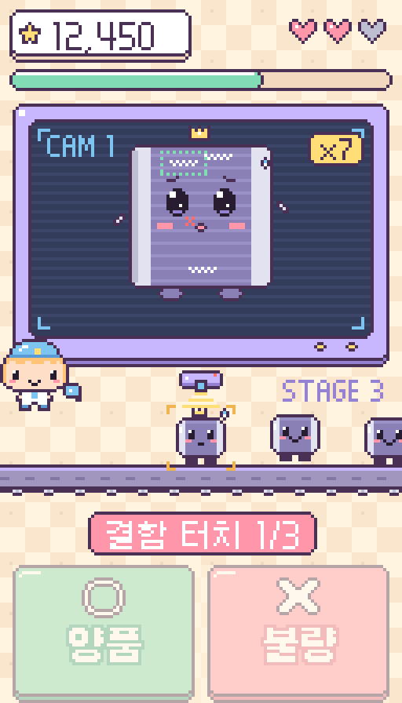

- 스테이지가 오를 때 나오는 왕관 달린 시트
- 결함이 2~4개 숨어 있음. 양품·불량 버튼은 쓰지 않고 **모니터 속 결함을 손가락(마우스)으로 모두 터치**해야 통과
- 안내 줄에 「결함 터치 1/3」처럼 찾은 개수 표시
- 결함이 없는 곳을 누르면 남은 시간 0.4초 감소

 

### 반장 지시

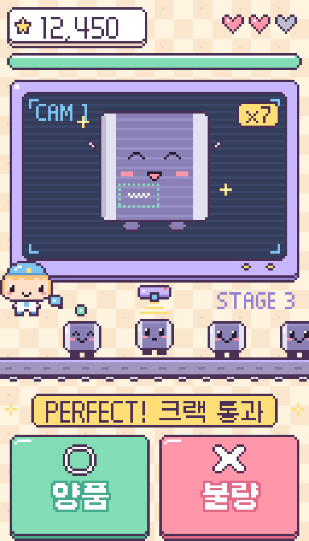

- 스테이지 2부터 가끔 안내 줄에 「○○만 불량! (5)」가 뜸
- 괄호 숫자만큼의 시트 동안 **지정한 결함만 불량**, 다른 결함은 양품으로 판정
  - 예: 「크랙만 불량!」 중에 핀홀이 나오면 양품
- 지시가 나오면 버튼 위 안내 줄을 꼭 확인

 

### 불량 도망과 고객 클레임

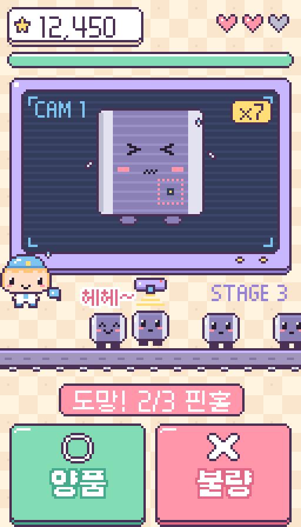

- 불량을 양품으로 넘기면 하트가 줄고 그 불량이 도망감 (「도망! 2/3」)
- 3마리가 도망가면 「고객 클레임!」 → 반품 시트가 돌아옴
- 반품 시트는 보스 시트와 같은 방식으로 결함을 모두 터치해서 처리

 

### 금색 전극

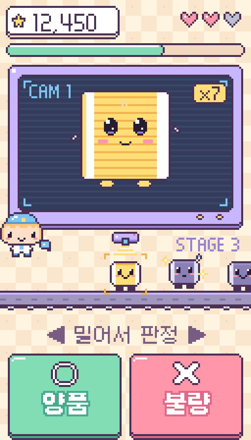

- 아주 가끔 노란 금색 시트가 나옴 (약 2.5%)
- 맞게 판정하면 +1000점

 

### 반짝 시트

- 반짝이가 붙은 시트 (약 7%). 맞게 판정하면 아이템 하나를 받음
  - 하트: 하트 1개 회복 (하트가 가득이면 +500점)
  - 시간 정지: 3초 동안 시간이 줄지 않음
  - 돋보기: 다음 3장 동안 결함 근처를 표시

## 7. 게임 끝

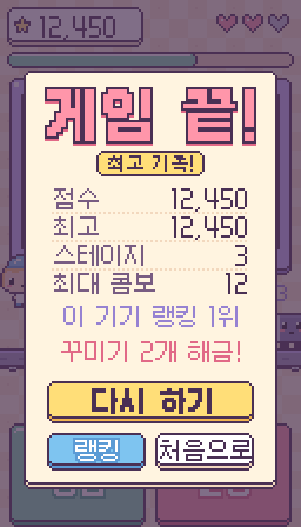

- 점수, 최고 점수, 스테이지, 최대 콤보, 랭킹 순위 표시
- 최고 기록이면 「최고 기록!」 표시, 새로 해금된 꾸미기가 있으면 알려 줌
- 「다시 하기」 · 「랭킹」 · 「처음으로」

 

## 8. 랭킹

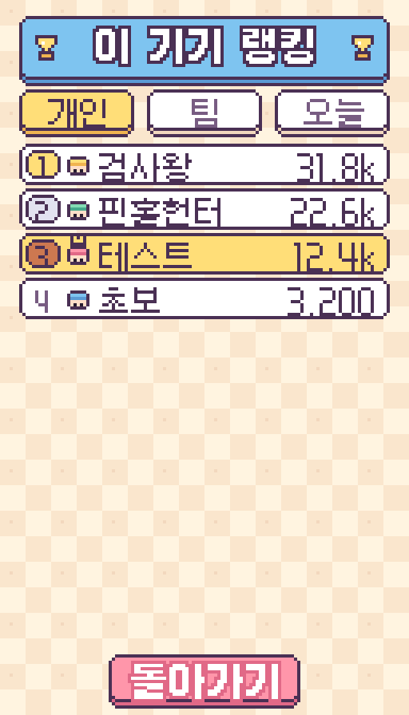

- 웹 공개판은 모두가 같은 랭킹을 씀 (기기마다 자동으로 구분, 로그인 없음)
- 탭 3개
  - 개인: 각자 최고 점수
  - 팀: 조직별 팀원 최고 점수 합계
  - 오늘: 「오늘의 판」 점수. 날짜가 바뀌면 새로 시작
- 큰 점수는 줄여서 표시 (예: 44.3k = 44,300점대, 1.23M = 123만 점대)
- 최고 점수는 내려가지 않음. 같은 기기에서 이름·팀을 바꾸면 기존 기록에 그대로 반영

 

## 9. 도감

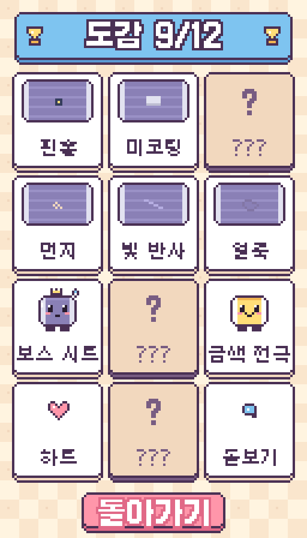

- 12칸: 결함 6종(핀홀·미코팅·크랙·먼지·빛 반사·얼룩), 보스 시트, 반품 시트, 금색 전극, 아이템 3종(하트·시간 정지·돋보기)
- 게임 중 처음 만나면 「도감 등록!」과 함께 채워짐
- 아직 못 본 칸은 「???」

 

## 10. 꾸미기

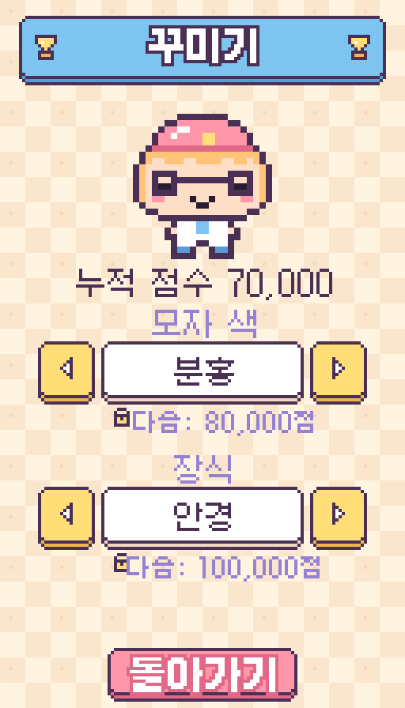

- 지금까지 얻은 점수를 모두 더한 **누적 점수**로 해금
- 모자 색

  | 하늘 | 분홍 | 민트 | 노랑 | 보라 | 구리 |
  |---|---|---|---|---|---|
  | 처음부터 | 1만 | 2.5만 | 5만 | 8만 | 12만 |

- 장식

  | 없음 | 리본 | 안경 | 왕관 |
  |---|---|---|---|
  | 처음부터 | 2만 | 6만 | 10만 |

- 고른 모습은 랭킹·채팅의 얼굴에도 표시됨

 

## 11. 채팅

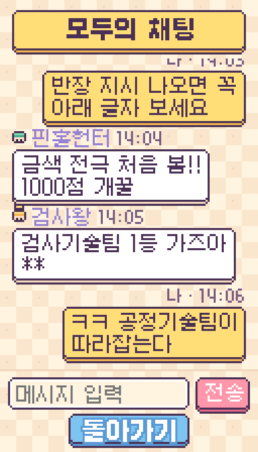

- 웹 공개판에서만 사용 가능
- 아래 입력칸에 쓰고 「전송」 또는 Enter
- 한 번에 40자, 3초에 1번까지 보낼 수 있음
- 최근 100개만 보관, 위로 끌어서 이전 글 보기
- 기본 비속어는 \* 로 가려짐

 

## 12. 고득점 요령

- 콤보를 끊지 않는 것이 가장 중요. 콤보 20이면 점수가 3배
- 확실하지 않으면 시간을 다 쓰기보다 빠르게 판단. 시간 초과도 틀린 것과 같음
- 먼지·빛 반사·얼룩은 결함처럼 보여도 양품
- 반장 지시 중에는 버튼 위 안내 줄의 지정 결함만 불량
- 피버 중에는 점수가 2배이므로 특히 신중하게
- 보스 시트는 모니터 구석까지 훑어보고 터치. 헛터치는 시간 감소
